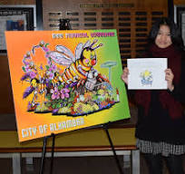
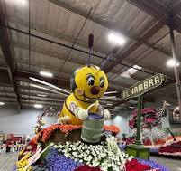
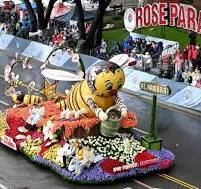
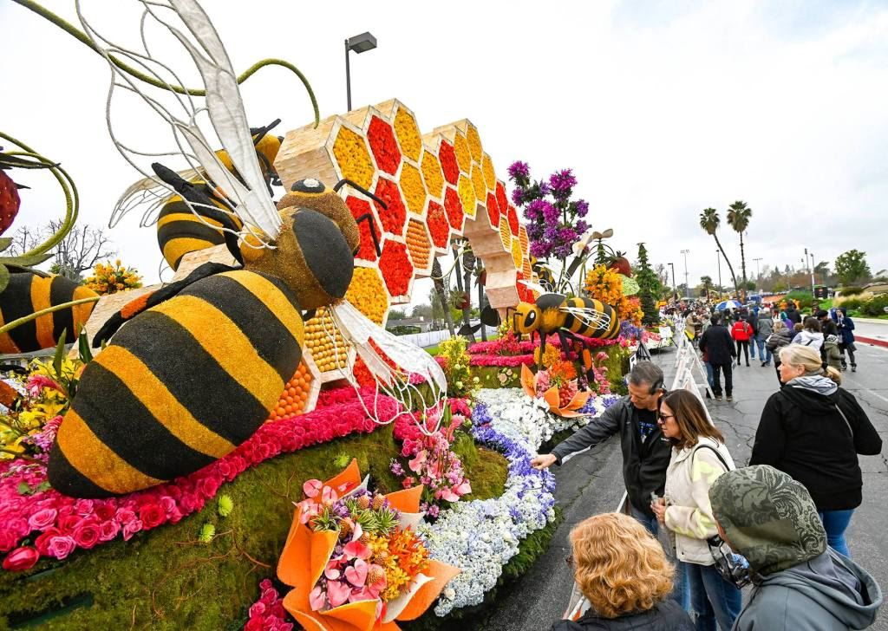

# Presentation to Alhambra High School Students

\
<https://github.com/wsphd/csun-alhambra/>

**[Wayne Smith, Ph.D.](mailto:wayne.smith@csun.edu)**\
**[Systems and Operations Department](https://www.csun.edu/nazarian/som)**\
**[David Nazarian College of Business and Economics](https://www.csun.edu/nazarian/college)**\
**[California State University, Northridge (CSUN)](https://www.csun.edu)**\
**Fall, 2026**

## Systems and Operations (SOM) Department Majors

* **Information Systems**
  * The study of Information Systems (IS) centers on the effective use of information technology—computers and telecommunications networks—to support management decision-making and corporate strategy, in addition to providing all necessary operational level support for an organization.

* **Global Supply Chain Management**
  * The Global Supply Chain Management Option prepares students for every area of supply chain activity. The range of positions in the supply chain management area include sourcing and procurement, demand planning and distribution, logistics management, transportation, warehousing, materials handling, order processing, and customer value analysis.

* **Systems and Operations Management**
  * The option in Systems and Operations Management prepares students for rewarding careers in various industries, such as aerospace, electronics, automotive, health care, airlines, transportation, biotechnology, software, and banking. The range of positions includes operations planning and scheduling, inventory and materials management, quality management, project management, systems analysis and design, decision support systems, and supply chain management.

* **Business Analytics**
  * The option in Business Analytics focuses on preparing students for careers in a very fast-growing field of business analytics. The program provides a strong foundation in business analytics that addresses the opportunities and challenges opened up by massive amounts of data, methodological developments, and the explosion in computing power and storage capacity. The program ensures that students build and develop the ability to apply their knowledge and skills to business problems for data-driven decision-making. The department also offers a minor in Business Analytics program, allowing students to pursue a secondary interest in business analytics.

## Majors (as might be applied to the City's Rose Parade float)

* **Information Systems**
  * *IT computers* (What is the number, configuration, and use of PCs and Macs?  Which Cloud services, such as AWS, should we use for servers and services?  Which files and file formats do we use of design objects?)
  * *IT networks* (Should we use texting, email, Slack, 'Gram, or something else for communications among various stakeholders? How do store and share data about float details securely?)
 
> 
 

* **Global Supply Chain Management**
  * *sourcing and procurement* (Which flowers can be locally sourced?  Which need to come from overseas?)
  * *demand planning and distribution* (How many of each type do we need?)
  * *logistics management and transportation* (How do we move the completed float from Irwindale to Pasadena?)
  * *warehousing and materials handling* (Do some flowers need to be kept chilled?  How much space do we need to build the float electronics?)
 

 

* **Systems and Operations Management**
  * *operations planning and scheduling* (How many volunteers do we need in the last week before Jan. 1 to attach flowers?)
  * *inventory and materials management* (Are all parts, and spare parts, cataloged, organized, and readily accessible?)
  * *quality management* (Does the final float design meet the initial specifications?)
  * *project management* (Are the scope, timeline, labor, materials, and risks being managed throughout the entire float lifecycle?)
  * *systems analysis and design* (Have we mapped out each process, each workflow, and related interactions to understand the entire float ecosystem?)
  * *decision support systems* (Have our analytical spreadsheets and software been programmed well enough to help leverage opportunities and overcome challenges?)
 

 

* **Business Analytics**
  * *descriptive analytics* (How many visitors came to see the floats on display this year?  How does that compare to last year?)
  * *diagnostic analytics* (Is there a statistically significant difference in visitors due to, say, weather?)
  * *predictive analytics* (How many families are likely to come next year?  How many senior citizens are likely to come next year?)
  * *prescriptive analytics* (Which volunteers should be staged on which days and at which times to visitors with the Alhambra float?)
 

